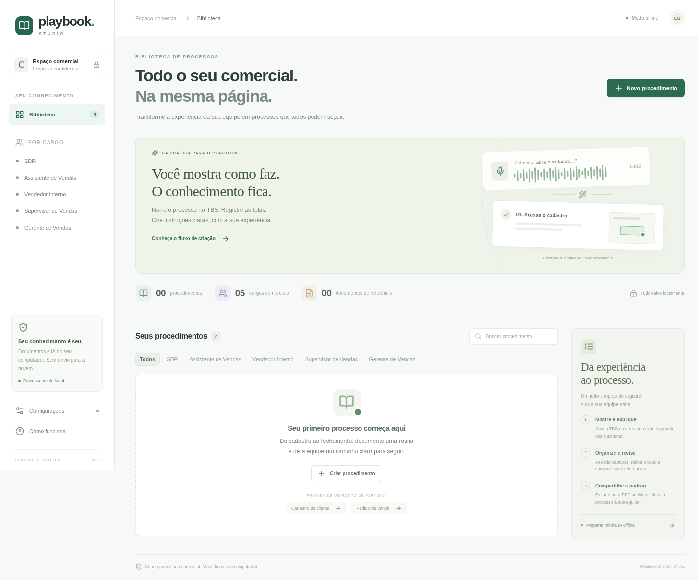

# Playbook Studio

Aplicativo desktop em português para transformar demonstrações de processos comerciais em instruções com capturas de tela. A empresa permanece identificada como **Empresa confidencial**. Os cargos iniciais são SDR, Assistente de Vendas, Vendedor Interno, Supervisor de Vendas e Gerente de Vendas, com foco em procedimentos do **Tecnicon Business Suite (TBS)**.



## Baixar para Windows

[Baixar o instalador de avaliação v0.1.1 para Windows x64](https://github.com/Amigo34Poa/Playbook/releases/download/v0.1.1/Playbook-Studio-0.1.1-Windows-x64.exe).

Consulte o [guia de primeiro uso](docs/PRIMEIRO-USO.md) e os demais arquivos na [página da versão](https://github.com/Amigo34Poa/Playbook/releases/tag/v0.1.1). O instalador foi gerado pelo GitHub Actions; seu download foi verificado com o SHA-256 publicado. Não é necessário instalar Node.js para usar o programa.

Em **Configurações → Guia e preparação da IA**, abra a pasta com `LEIA-ME.md` e `Preparar-IA.ps1`. Os motores e modelos precisam de uma preparação separada e ficam por padrão em `%LOCALAPPDATA%\PlaybookStudio\IA`. A biblioteca fica na pasta de dados do usuário.

## O que esta versão faz

- Organiza procedimentos por cargo e categoria, com objetivo e etapas editáveis e reordenáveis.
- Captura o monitor escolhido quando o mouse fica parado por aproximadamente 1 segundo. Destaca a região do cursor, respeitando a escala e a posição do monitor. Não reconhece semanticamente os limites de campos ou botões.
- Grava áudio PCM WAV mono a 16 kHz. Transcreve trechos de aproximadamente 20 segundos com **whisper.cpp**, no próprio computador.
- Usa **llama.cpp** e um modelo GGUF local para propor redação profissional em português. A proposta precisa ser revisada antes de substituir as etapas e pode ser desfeita enquanto o procedimento estiver aberto.
- Associa imagens à narração por horário; a associação pode ser corrigida no editor. As imagens não são enviadas a um modelo de visão.
- Importa texto de PDF, Word `.docx`, `.txt` e `.md`; compara divergências e sugere complementos com a IA local. PDF digitalizado e imagens dentro de documentos não passam por OCR nesta versão. Tabelas do Word são extraídas como texto, sem preservar o layout.
- Exporta cada procedimento como **PDF** ou **Word**, com as capturas associadas embutidas nas etapas.
- Salva a biblioteca localmente, com gravação atômica e cópia anterior em `workspace.backup.json`.

Não há integração com APIs de IA na nuvem, chave de API, autenticação no TBS ou acesso ao banco de dados do TBS. Você demonstra os processos conforme a configuração real da sua empresa. Os exemplos de cadastro e pedido são pontos de partida vazios, sem instruções inventadas sobre o sistema.

## Executar e gerar o instalador no Windows

Pré-requisitos para desenvolvimento: **Windows 10 ou 11 x64 e Node.js 24 LTS**. O usuário do instalador não precisa instalar Node.js.

```powershell
npm ci
npm run dev
```

Para gerar o instalador:

```powershell
npm run dist:win
```

O resultado fica em `release/Playbook-Studio-0.1.1-Windows-x64.exe`. O instalador NSIS permite escolher a pasta e criar atalho. Nesta versão o instalador não tem certificado de assinatura da empresa. O fluxo em `.github/workflows/windows.yml` gera o artefato em um runner Windows e publica uma versão de avaliação quando uma tag `v*`, correspondente à versão do aplicativo, passa pelas verificações. O empacotamento usa `--publish never`; a publicação acontece somente no job dedicado, depois dos testes.

Para gerar uma distribuição portátil, use `npm run dist:portable`. A geração do instalador NSIS neste Linux ficou bloqueada pela ausência de Wine; a distribuição portátil foi gerada com sucesso. O comando de instalador permanece preparado para execução no Windows.

## Preparar a IA completamente offline

O processamento é local. Os motores e modelos precisam existir no computador antes do uso. A preparação pode acontecer em outra máquina conectada à internet, seguida de transferência dos arquivos por mídia local.

Recomendação inicial: **16 GB de RAM**, CPU x64 moderna com AVX2, 4 threads e aproximadamente 4 GB livres para motores e modelos. Os binários CPU escolhidos não exigem GPU; hardware sem as instruções requeridas pelos binários pode precisar de outra compilação oficial. O tempo de transcrição e geração varia com o computador. A fila pode terminar depois da demonstração.

### Preparação assistida no Windows

No PowerShell, execute a partir da pasta do projeto:

```powershell
.\scripts\Preparar-IA.ps1
```

O script baixa distribuições oficiais fixadas de whisper.cpp e llama.cpp, verifica os SHA-256 publicados nos releases e baixa os modelos a partir de uma revisão imutável do Hugging Face, verificando seus hashes LFS. Ele mantém TLS e as verificações de integridade. Se a política do computador impedir scripts, use o procedimento manual ou o suporte de TI da empresa.

Os arquivos ficam por padrão em `%LOCALAPPDATA%\PlaybookStudio\IA`. Abra **Configurações** no aplicativo e selecione:

| Campo | Arquivo |
| --- | --- |
| Motor de voz | `whisper-cli.exe` do whisper.cpp v1.7.6 |
| Modelo de voz | `ggml-small.bin`, multilíngue; evite modelos `.en` para português |
| Motor de texto | `llama-server.exe` do llama.cpp b11669 |
| Modelo de texto | `qwen2.5-3b-instruct-q4_k_m.gguf` |

Preserve as DLLs junto aos respectivos executáveis. Se o Windows informar ausência de VCRUNTIME ou MSVCP, instale o Microsoft Visual C++ Redistributable x64 a partir do site oficial da Microsoft. Clique em **Salvar** e depois em **Testar motor de texto**. Faça uma gravação curta em português para verificar também o motor de voz.

### Preparação manual / computador sem internet

Obtenha os arquivos oficiais em uma máquina conectada e confira os hashes fornecidos pelas origens:

- [whisper.cpp v1.7.6 — whisper-bin-x64.zip](https://github.com/ggml-org/whisper.cpp/releases/tag/v1.7.6)
- [llama.cpp b11669 — distribuição Windows CPU x64](https://github.com/ggml-org/llama.cpp/releases/tag/b11669)
- [Whisper multilíngue — ggml-small.bin](https://huggingface.co/ggerganov/whisper.cpp)
- [Qwen2.5 3B Instruct GGUF — Q4_K_M](https://huggingface.co/Qwen/Qwen2.5-3B-Instruct-GGUF)

Transfira as pastas completas, selecione os quatro arquivos em Configurações e teste com a internet desconectada. Modelos e motores têm licenças próprias; mantenha os avisos das distribuições e confira suas condições antes de redistribuir modelos com a empresa.

O aplicativo inicia o servidor de texto automaticamente, exclusivamente em `127.0.0.1`, em porta local livre e com autenticação efêmera. Não expõe a IA na rede. A preparação inicial é o único passo que precisa de downloads; o aplicativo não implementa downloads nem chamadas a serviços externos.

## Gravar um processo no TBS

1. Crie um procedimento e escolha o cargo responsável e a categoria.
2. Clique em **Gravar processo**, escolha o monitor e o microfone e inicie. Sem IA configurada, é possível capturar somente as telas e escrever manualmente.
3. A janela é minimizada. Abra o TBS, explique cada ação e pare o mouse sobre o campo ou botão por aproximadamente um segundo. O monitor inteiro é capturado; há até 120 imagens por sessão e intervalo mínimo automático de 2,5 segundos.
4. **Ctrl + Shift + Espaço** captura manualmente. **Ctrl + Shift + Enter** encerra. Se algum atalho já estiver ocupado por outro programa, retorne à janela e clique em **Encerrar**.
5. Aguarde a fila de transcrição e a proposta de texto. Confira os termos, a ordem das ações e as imagens antes de aplicar. A narração original continua disponível.
6. Importe documentos existentes, use a aba **Revisão** para compará-los e ajuste as etapas. A análise é uma sugestão do modelo local e precisa de conferência humana.
7. Associe a cada etapa a imagem correta usando o seletor abaixo da descrição. Remova capturas desnecessárias e revise informações confidenciais antes de compartilhar.
8. Clique em **Exportar** e escolha PDF ou Word. Aguarde **Salvo neste computador** antes de fechar.

## Dados, limites e recuperação

- Os dados ficam em `%APPDATA%\Playbook Studio` no Windows (caminho padrão do Electron), sem sincronização na nuvem. O armazenamento não é criptografado; use as proteções de disco e de acesso do Windows conforme a política da empresa.
- Faça backup de `workspace.json` e `workspace.backup.json`, com o aplicativo fechado. As imagens e os textos importados ficam embutidos na biblioteca.
- Em caso de falha de transcrição, a aba Narração permite tentar novamente ou salvar o trecho WAV. Uma cópia de recuperação permanece em `audio-recovery`, dentro da pasta de dados, quando o processamento falha. Os arquivos dessa pasta podem ser recuperados e removidos manualmente depois de conferidos. Áudios transcritos com sucesso são removidos; os textos permanecem.
- Até 100 procedimentos, 500 etapas e 300 capturas por procedimento; biblioteca de até 250 MB. Cada arquivo de referência pode ter até 15 MB e 200 mil caracteres extraídos; até 30 referências por procedimento. Procedimentos extensos devem ser divididos.
- O contexto da IA tem limite de tamanho; se as referências e a narração forem longas demais, o aplicativo pede para dividir o procedimento ou reduzir o conteúdo, sem truncar silenciosamente a fonte.
- A edição de texto é possível sem motores de IA. O modo navegador é uma prévia de edição: não simula recursos nativos, não grava a tela e não exporta documentos.
- Esta versão exporta um procedimento por vez. Ainda não há montagem de um único volume com todos os cargos, edição colaborativa ou controle de acesso por usuário.

## Validação

```powershell
npm test
npm run build
npx playwright install chromium
npm run test:ui
npm run test:desktop
```

`test:desktop` precisa de uma sessão gráfica e de um monitor disponível; usa perfil temporário próprio. Os testes exercitam IPC com isolamento, persistência real, captura nativa e destaque, PDF, Word com imagem, importação dos três formatos e recuperação de áudio após falha. Não medem qualidade de reconhecimento de voz ou de redação.

Validados em Linux com monitor virtual e no runner Windows do GitHub Actions: build TypeScript/Vite, seis testes de domínio, três testes de interface e fluxo desktop nativo, incluindo exportações/importações reais e microfone simulado. A [execução da versão v0.1.1](https://github.com/Amigo34Poa/Playbook/actions/runs/39094491030) concluiu com sucesso e publicou o instalador. **A inferência com modelos reais, o script de preparação da IA e o uso do aplicativo instalado com microfone real no Windows 10/11 e no TBS da empresa ainda exigem validação nas máquinas de destino.** O ambiente de desenvolvimento bloqueou o acesso ao Hugging Face, portanto os modelos não foram baixados nem a qualidade da IA foi avaliada aqui.

Antes de uso pela equipe, execute em cada versão do Windows uma demonstração curta no TBS real, incluindo monitor com escala de 125%/150%, múltiplos monitores quando usados pela empresa, microfone, associação de imagens, exportação e reabertura dos arquivos. Repita com a internet desconectada após instalar os modelos. A compatibilidade foi projetada para Windows 10/11 x64; não há evidência para prometer funcionamento perfeito nessas máquinas sem essa validação.
